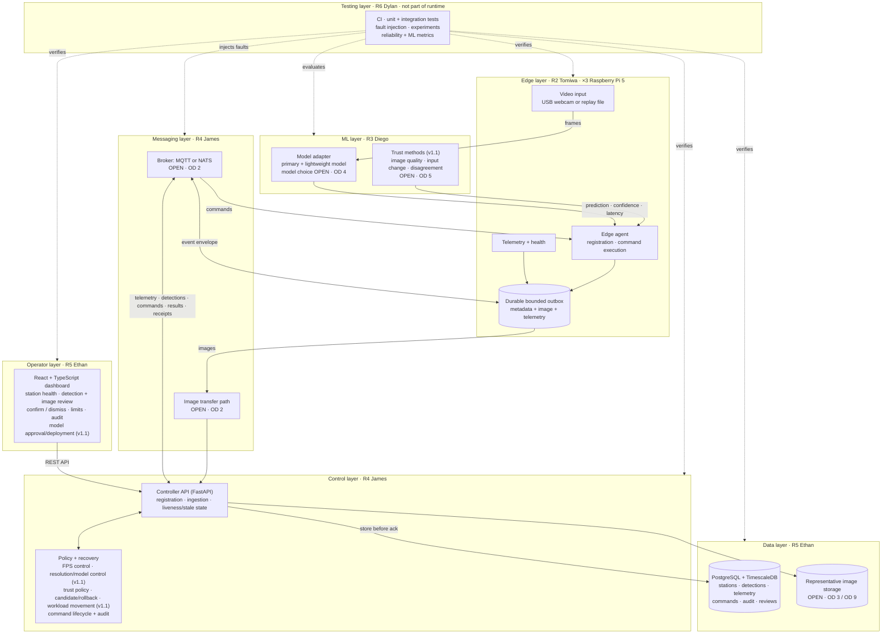
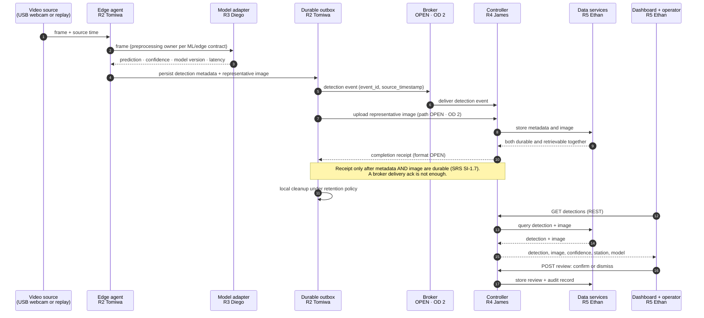

# Architecture overview

**Status:** Draft. This describes the *intended* design; none of these components exist yet.
**Owner:** R1 (Anthony), with all subsystem owners.
**Conventions:** [ADR 0008](../decisions/0008-architecture-documentation-conventions.md). This
document is the maintained source for the logical view and the primary data flow; the
[v1.1 SRS §4 figures](../specifications/v1.1/diagrams/) are a frozen snapshot. The deployment
view is in [deployment.md](deployment.md#deployment-view).

## 1. Purpose

EmberFlow is a distributed edge research prototype. Three Raspberry Pi 5 stations run smoke
inference locally on live or prerecorded video. A central FastAPI controller registers the
stations, collects telemetry and complete detection/image evidence, tracks health and trust,
and coordinates FPS/resolution/model adaptation, workload movement and model lifecycle.
FPS reduction is the first policy slice. Operators review detections in a
React + TypeScript dashboard. Data is stored in PostgreSQL + TimescaleDB.

The research contribution is the **integration**: local inference, health monitoring, offline
continuity, human review and measured recovery. It is not a new detector.

## 2. Logical component view

EmberFlow has six runtime layers plus a Testing layer that verifies all of them. Each layer has
one owner, and every arrow between layers is a contract (see §3.2). Items marked *v1.1* are
required by the v1.1 SRS; team ratification of that revision is pending
([ADR 0007](../decisions/0007-october-22-review-baseline.md)).



ML code runs **on the Pi** but is its own layer, because Diego owns it and the ML/edge contract
(SRS SI-1.6) is a real boundary. The controller handles policy and collects events; it does not
run per-frame inference. This is a logical view. Physical placement (three Pis and one existing
central computer on wired Ethernet) is in [deployment](deployment.md).

## 3. Layers, interfaces and components

### 3.1 Layers

| Layer | Owner | Runs on | Responsibility |
|---|---|---|---|
| Edge | R2 Tomiwa | Pi 5 / simulated station | Video input, local execution, telemetry, durable offline evidence, command execution |
| ML | R3 Diego | Pi 5 (inside the edge agent) | Models, inference contract, trust methods, model evaluation |
| Messaging | R4 James | Central host | Transport between stations and controller; image transfer path |
| Control | R4 James | Central host | Registration, ingestion, liveness, policies, command lifecycle, model rollout, audit |
| Data | R5 Ethan | Central host | Durable records, telemetry time series, images, reviews, audit |
| Operator | R5 Ethan | Operator browser | Health/trust view, image review, configuration, model approval, audit history |
| Testing | R6 Dylan | Dev machines, CI, lab | CI, automated tests, fault injection, experiments, reliability and ML metrics. Not part of the running system |

Messaging and Data are separate layers even though the ticket groups them: they have different
owners and different open decisions (OD 2 vs OD 3). See ADR 0008.

### 3.2 Interfaces between layers

| Boundary | Contract | Status | Owners |
|---|---|---|---|
| Edge ↔ ML | ML/edge contract: frame layout, preprocessing, artifact/runtime, output schema, errors (SRS SI-1.6) | Not written; depends on OD 4 | R3 + R2 |
| Edge ↔ Messaging | Edge event envelope and payloads ([contracts](../api/contracts.md)) | Proposal v0; [v1.1 gaps](../api/contracts.md#7-gaps-before-v11-integration) open | R2 + R4 |
| Edge → Messaging (images) | Image upload and durable completion receipt (SRS SI-1.7) | **OPEN** · OD 2 / OD 9 | R2 + R4 + R5 |
| Messaging ↔ Control | Broker client inside the FastAPI app | **OPEN** · [ADR 0004](../decisions/0004-messaging.md) | R4 |
| Control ↔ Data | Database schema and migrations | Not written; OD 3 | R5 + R4 |
| Control ↔ Operator | REST API ([contracts §5](../api/contracts.md)) | Proposal v0 | R4 + R5 |
| Testing ↔ all layers | [Test plan](../testing/test-plan.md), fault-injection hooks, CI | Draft; CI runs contract tests | R6 + each owner |

Changing any of these contracts needs the reviewers listed in
[CONTRIBUTING.md](../../CONTRIBUTING.md#cross-subsystem-changes).

### 3.3 Components in each layer

| Layer | Component | Responsibilities | Owner | Repo path |
|---|---|---|---|---|
| Edge | Video input | Camera or prerecorded-file frames; adjustable processing FPS | R2 | `edge/video` |
| Edge | Edge telemetry | CPU, memory, temperature, latency, FPS, network, camera, model version | R2 | `edge/telemetry` |
| Edge | Edge buffer | Durable metadata/image evidence and retained telemetry; bounded replay with stable identity/time | R2 (+R4) | `edge/buffering` |
| Edge | Edge agent | Registration, messaging client, command execution and reporting | R2 | `edge/agent` |
| ML | Inference | Primary + lightweight model; emits prediction, confidence, model version, latency | R3 (interface), R2 (integration) | `ml/inference` |
| Messaging | Messaging | Transport for telemetry, detections, commands, results, receipts | R4 | `controller/messaging` |
| Control | Controller API | Registration, ingestion, health/stale checks, REST for dashboard | R4 | `controller/api` |
| Control | Policy + recovery | Resource/trust policies, command verification, candidate rollout/rollback, workload coordination, audit | R4 | `controller/policies`, `controller/recovery` |
| Data | Storage | Stations, complete detections/images, telemetry, deployments/comparisons, review and audit | R5 | `data/` |
| Operator | Dashboard | Health/trust, image review, configurable limits, model approval/deployment and audit | R5 | `dashboard/frontend` |
| Testing | Testing & experiments | Tests, fault injection, reliability metrics | R6 | `testing/`, `experiments/` |

**Design principle:** use practical modules inside **one** FastAPI app and **one** edge agent
rather than many separately deployed microservices.

## 4. Primary data flows

### 4.1 Normal operation (primary data flow)

Video → edge → model → controller → database → dashboard. The v1.1 snapshot of this flow is SRS
§4 [Figure 3](../specifications/v1.1/diagrams/edge_evidence_flow.mmd).



Telemetry and heartbeats follow the same edge → outbox → broker → controller → data path
(steps 5–6 and 8), without an image. If any step after 4 fails, the evidence stays in the outbox
and is retried; see §4.2 and §4.3.

### 4.2 Network outage

- The Pi **keeps** reading video and running inference.
- Accepted metadata plus one recoverable image per event, and retained telemetry, are written to a bounded durable outbox. Record accepted/rejected evidence and storage failures; do not promise unlimited retention.
- The controller sees that the station has stopped reporting and marks its information
  **stale**. It does **not** assume the Pi has stopped processing.
- The dashboard shows the station as stale and when it last reported.

### 4.3 Reconnection and replay

- Buffered records replay with their **original `event_id` and `source_timestamp`**.
- Metadata and image may arrive separately; expose incomplete state until both are durable,
  integrity-checked under the agreed policy, and jointly reviewable. Only a complete durable
  receipt permits post-receipt local cleanup. Legacy v0 metadata acks are insufficient.
- Retransmission is allowed after a lost receipt; deduplicate logically by stable event identity
  and never confuse existing metadata with a complete image. Test partial upload and restart.
- Delayed telemetry stays in history and must not overwrite newer measurements. Source time,
  session/sequence and clock validity guide ordering; current liveness needs fresh contact under
  the agreed timeout rules. Neither replay arrival nor an unchecked source timestamp proves health.
- FPS commands that expired while the station was offline are **never applied**. The station
  reports `failed` with an expiry reason.

### 4.4 FPS adaptation (first required recovery slice)

```
Pi reports resource telemetry
  -> controller evaluates configurable policy over a stable observation window
     (not on a single noisy sample) and records baseline telemetry
  -> controller creates FPS command (unique command_id, station_id, requested_fps,
     created_at, expires_at, policy_reason)                        state: requested
  -> Pi receives, checks expiry, accepts                            state: accepted
  -> Pi changes processing FPS and reports actual applied FPS      state: applied
  -> later telemetry compared with baseline by controller          state: verified | failed
  -> cooldown / hysteresis window prevents oscillation
```

An acknowledgment alone is **not** proof of recovery. Only `verified` means the measured FPS
changed and the resource condition improved compared with the baseline.

Lifecycle states (proposal; see [contracts](../api/contracts.md#4-fps-command-lifecycle)):

| State | Set by | Meaning |
|---|---|---|
| `requested` | Controller | Command created and sent; baseline recorded |
| `accepted` | Station | Station received an unexpired command |
| `applied` | Station | Station changed its processing FPS; reports actual FPS |
| `verified` | Controller | Later telemetry confirms the FPS change and an improvement vs. baseline |
| `failed` | Either | Rejected, expired, not applied, or no measured improvement (with reason) |

Trigger thresholds, observation windows, target FPS, cooldown and success criteria are
**not decided**. They must be measured on the chosen Pi 5 configuration. Any numbers in
examples (such as 10 → 5 FPS) are illustrative only.

### 4.5 Trust, model lifecycle and workload movement

Diego supplies the image-quality/input-change/disagreement methods and versioned models;
Tomiwa integrates them on the shared platform. James coordinates policy, candidate/shadow
comparison, limited rollout, model changes and known-good rollback. Ethan exposes comparison,
human feedback, configuration/deployment controls and audit records. A candidate does not
control active alerts during shadow evaluation. Numerical methods/thresholds remain open.

Resolution/model control and workload movement remain required alongside FPS control. A moved
worker must have a source accessible on its destination; a USB webcam does not move across
Ethernet by itself. Define that scenario before the migration test. Every action needs a
correlated outcome and reproducible before/action/after evidence, not merely a command ack.

## 5. Cross-cutting concerns

- **Identity:** each station has a stable `station_id` set in its config.
- **Time:** all timestamps are UTC RFC 3339. Pis should run NTP. Clock skew between Pis and the
  central host is a known risk; store source and receive time, session/sequence and clock validity. Use fresh heartbeat/contact rules for liveness and monotonic durations for latency; neither arrival order nor source time alone proves current health.
- **Idempotency:** `event_id` (UUID) is assigned once at the source and never regenerated.
- **Versioning:** each message carries `schema_version`; breaking changes bump it.
- **Security (prototype level):** no secrets in Git, configuration via `.env`. Broker and API
  authentication depend on the messaging decision and are still to be designed.

## 6. Open architectural decisions

Use the [decision register](../decisions/README.md) for all ten SRS open items and closure gates.
Physical Ethernet, USB camera type and required image retention are in the review baseline;
exact parts, transport/receipt, algorithms, profiles, capacity, budget and host configuration
remain open. The [legacy contract gaps](../api/contracts.md#7-gaps-before-v11-integration) must
be closed before treating Proposal v0 as an integration contract.
