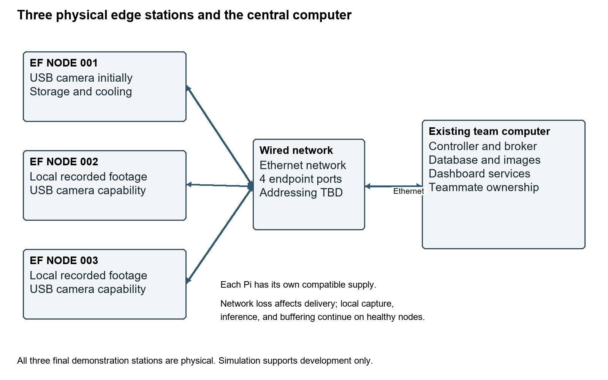
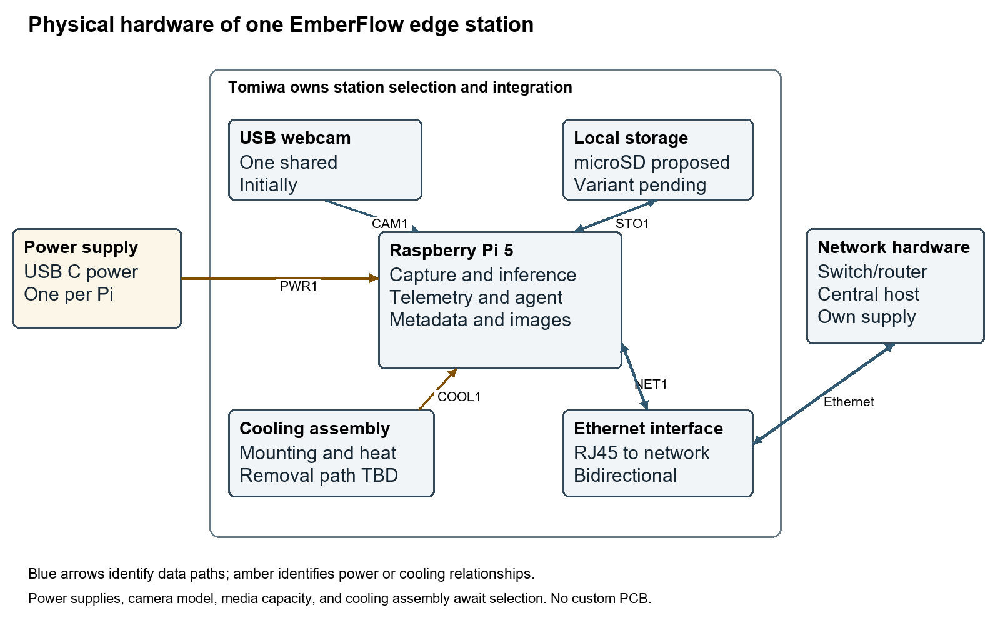
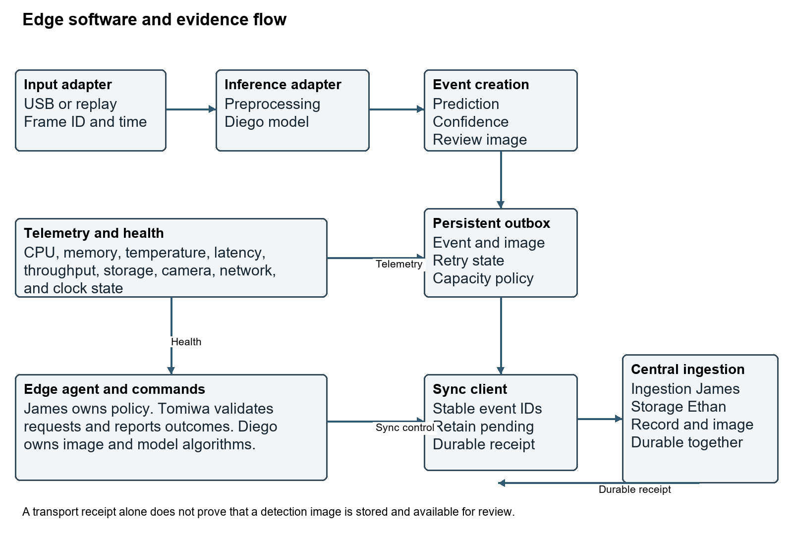

# EmberFlow Software Requirements Specification

System behavior hardware interfaces and verification baseline

EF-SRS-001 | Revision 1.1 | October 22 2026 | Review draft

This SRS defines EmberFlow's required system behavior, hardware and software interfaces, data contracts, named ownership, and acceptance evidence. Revision 1.1 aligns the software baseline with the physical Pi 5 platform and complete offline detection-review evidence.

Revision 1.1 implements the hardware-focused document revision approved by Tomiwa on October 22, 2026. It is a review draft for faculty and team reconciliation. Requirements describe intended behavior; no procurement, trained model, hardware benchmark, or implementation result is asserted by this document.

### Document control

| Revision | Basis |
| --- | --- |
| 1.0 | Original attached specification; retained as the source baseline. |
| 1.1 | Named owners; Pi 5 indoor platform; USB camera and wired Ethernet; existing central host; offline image evidence; physical diagrams; interface and verification updates. |

Shall identifies an acceptance obligation; should identifies a recommendation; may identifies an option. A chosen architecture is distinguished from an unselected part or proposed implementation. The professor clarification that no custom PCB is required was reported by Tomiwa [S6]; it does not waive unrelated ECE coursework or writing obligations.

## 1 Introduction

The audience is the six-person team, faculty, reviewers, and future maintainers. Source SRS identifiers remain stable. New hardware, interface, offline-image, and handoff requirements extend the baseline. Existing model monitoring, candidate lifecycle, controlled adaptation, and comparative evaluation remain required; this revision does not silently convert them into stretch goals.

The detailed edge design is EF-R2-001 revision 1.1 and the team ownership document is EF-TEAM-001 revision 1.1. The SRS defines cross-subsystem obligations; the edge document decomposes Tomiwa's contribution. Where the detailed transport/schema or a numerical target is pending, close the named open decision before the corresponding qualification test. No fabricated component selection or performance result fills that gap.

## 2 Overall description and operating environment

| Area | Revision baseline |
| --- | --- |
| Physical stations | Three Raspberry Pi 5 edge stations; same supported platform configuration. |
| Live video | One USB webcam initially. Demonstrate that the same camera can operate on each station in turn. |
| Other video inputs | Local prerecorded wildfire footage on the other two stations and for repeatable comparisons. |
| Location | Indoor research demonstration with available mains power; remote outdoor deployment is not required. |
| Central host | An existing team laptop or desktop hosts controller, database, and dashboard services. |
| Network | Wired Ethernet local network through a suitable switch or router. |
| Offline evidence | Detection metadata, one representative image per detection event, and telemetry under a documented retention policy. |
| Custom circuitry | No custom PCB is required, per the professor clarification reported by Tomiwa. |
| Procurement status | No hardware purchased or firmly selected; no total hardware budget set at revision time. |
| Model status | Lightweight YOLO-family candidates and FIgLib research; no final model, trained artifact, or measured Pi benchmark documented in reviewed sources. |

The system processes wildfire imagery locally while monitoring computing health and input/model trust. A central controller receives current and delayed data, applies policy, coordinates model lifecycle and recovery, and exposes operator state through persistent services and a browser dashboard. A connected device can still be unhealthy or produce unreliable imagery; a disconnected device can remain locally functional.

Operating assumptions include a supported Linux environment on each Pi, a locally available webcam or replay file, a model compatible with selected hardware, and an identified existing central computer. Power loss is distinct from network loss. No UPS, battery, outdoor enclosure, cellular service, extra microcontroller, or custom PCB is promised by this revision. The core network is a local wired deployment; any external dependency needed at runtime must be documented and must not defeat the offline-inference requirement.

## 3 Stakeholders roles and ownership

| Role | Member | Ownership |
| --- | --- | --- |
| R2 | Tomiwa Aluko | Edge hardware and embedded platform |
| R1 | Anthony Terry | Architecture and system integration |
| R3 | Diego Mendoza | Machine learning and computer vision |
| R4 | James Connolly | Backend and central controller |
| R5 | Ethan McKissic | Dashboard and shared persistence |
| R6 | Dylan Mcintee | Reliability and validation |

Tomiwa is the only Computer Engineering member; the other five members are Computer Science students. James also appears as Gabe or Gabriel in source documents and Jira. This revision uses James Connolly consistently for formal ownership. Ownership assigns accountability without excluding shared integration, testing, and documentation.

| Workstream | Primary owner | Support |
| --- | --- | --- |
| System architecture and interface coordination | Anthony Terry | All owners |
| Physical edge hardware and connection diagrams | Tomiwa Aluko | Anthony; Diego for resource constraints |
| Power cooling storage and camera selection | Tomiwa Aluko | Diego; Dylan for measurement |
| Edge agent camera adapters telemetry | Tomiwa Aluko | James; Diego |
| ML dataset training and model artifacts | Diego Mendoza | Tomiwa for runtime measurements |
| Image quality model disagreement and input change methods | Diego Mendoza | Dylan; Tomiwa integrates execution |
| Central policy messaging and ingestion | James Connolly | Anthony; Tomiwa |
| Central database snapshot storage and review availability | Ethan McKissic | James; Tomiwa supplies evidence |
| Local metadata image outbox and sync client | Tomiwa Aluko | James and Ethan define durable receipt |
| Model deployment coordination and rollback policy | James Connolly | Diego; Tomiwa executes edge changes |
| Dashboard and operator workflows | Ethan McKissic | James; Diego for result meaning |
| Fault injection comparative evaluation and validation | Dylan Mcintee | All owners |
| Shared release reproducibility and integration | Anthony Terry | Dylan; all owners |

## 4 Architecture and deployment views

Normal flow: source frames enter the edge adapter; Diego's selected methods execute through the supported runtime; the station creates results and review events; local persistence protects pending evidence; James's ingestion and Ethan's storage make complete records/images available to the operator. Commands flow from controller policy to validated edge execution with correlated outcomes. During outage, local processing and bounded buffering continue; replay after reconnect preserves historical source times.

## 5 External interface requirements

### 5 1 User interfaces

| ID | Requirement |
| --- | --- |
| UI-1.1 | The dashboard shall show registered stations and their current connectivity and health states. |
| UI-1.2 | The dashboard shall display a detection image, confidence, station, source timestamp, model version, and recent system history. |
| UI-1.3 | The dashboard shall allow authorized operators to configure temperature, memory, latency, throughput, and manual-review limits. |
| UI-1.4 | The dashboard shall provide model approval and deployment controls appropriate to the research prototype. |
| UI-1.5 | The dashboard shall expose system and operator audit history. |

### 5 2 Hardware interfaces

| ID | Requirement |
| --- | --- |
| HI-1.1 | Each station shall accept the selected USB webcam and local prerecorded footage through the common edge platform. The initial system shall include one USB webcam. |
| HI-1.2 | Each station shall expose available host telemetry including temperature and memory usage. |
| HI-1.3 | The final demonstration shall use three physical Raspberry Pi 5 stations. Simulated nodes may support development but shall not satisfy the final physical-station gate. |
| HI-1.4 | Each station shall use a documented compatible power supply, storage medium, and cooling arrangement verified under the frozen test profile. |
| HI-1.5 | The three stations and existing central computer shall connect through a documented wired Ethernet local network. |
| HI-1.6 | The hardware design shall include a physical block diagram, connection/interface record, bill of materials, and per-station configuration inventory. |
| HI-1.7 | The platform shall support indoor demonstration using available mains power. Outdoor enclosure, autonomous field power, and independent remote deployment are outside this revision baseline. |
| HI-1.8 | The common station configuration shall be verified with the shared webcam on each of the three stations in turn. Three simultaneous live cameras are not required. |
| HI-1.9 | The central services shall run on an identified existing team laptop or desktop with documented Ethernet access and service prerequisites. |

| ID | Endpoints | Physical connection | Required record |
| --- | --- | --- | --- |
| PWR1 | Supply to each Pi | USB C input; power into Pi | Record supply/cable ratings and combined board, webcam, storage, and cooling demand. Verify power-status indications under representative load. No custom power circuit. |
| CAM1 | USB webcam to active station | USB data into Pi; peripheral power from Pi | Document USB version, device identity, driver, video mode, frame format, cable, power demand, and recovery. Only one webcam is required initially. |
| STO1 | Pi to local storage | Bidirectional local storage interface | Proposed microSD; final media/interface pending comparison. Retain OS, model versions, event metadata, snapshots, telemetry, and logs within documented quotas. |
| NET1 | Each Pi to local network | Bidirectional Ethernet through RJ45 | Three station links. Record addresses, negotiated link, routes, application endpoints, retries, and disconnect behavior. Link presence and controller reachability are separate states. |
| NET2 | Central host to local network | Bidirectional Ethernet | Existing host uses native Ethernet or compatible adapter. Router addressing or switch-only static addressing is a documented integration decision. |
| COOL1 | Cooling to each Pi | Thermal path; electrical connection if active | Record mounting, airflow clearance, power/control connection, and observed thermal behavior for the selected assembly. Do not assume a fan connector before selecting the assembly. |

### 5 3 Software and communication interfaces

| ID | Requirement |
| --- | --- |
| SI-1.1 | The central service shall expose documented APIs for dashboard and integration use. |
| SI-1.2 | Edge/controller messaging shall use a documented MQTT- or NATS-based contract after the team records its selection. The image-transfer path shall be documented separately. |
| SI-1.3 | Central persistent records shall use PostgreSQL or its TimescaleDB extension as documented in the team decision record. Redis may support optional caching or ephemeral state. |
| SI-1.4 | Model artifacts shall be versioned and associated with deployment identifiers. |
| SI-1.5 | All inter-service message schemas and API payloads shall be version-controlled and documented. |
| SI-1.6 | The ML/edge contract shall define frame layout, preprocessing owner, model artifact/dependencies, output schema and units, errors, and supported hardware/runtime. |
| SI-1.7 | Detection ingestion shall acknowledge successful completion only after metadata and its representative image are durably stored and retrievable together. A broker delivery acknowledgment alone shall not satisfy this contract. |
| SI-1.8 | Shared telemetry contracts shall distinguish source time from receive time and include station/session identity and sequence information sufficient to detect stale or replayed state. |

Physical Ethernet is selected; MQTT versus NATS and the image transfer protocol remain open. A proposed arrangement uses messaging for heartbeat/telemetry/commands and an API for image upload, but no transport-specific success semantics are assumed. Document address assignment, network routes, broker/API endpoints, schema versions, validation, retry, and durable completion before integration. Ethernet alone does not provide application delivery guarantees.

The ML contract includes input shape/layout, pixel/channel order, preprocessing ownership, artifact/dependency/runtime versions, confidence semantics, latency boundary, frame/result association, and failure behavior. The shared event envelope includes schema version, station/session identity, event/frame identity, source time, sequence where appropriate, and payload. Source time and receipt time remain distinct; clock validity and elapsed-duration measurements must be documented.

## 6 Functional requirements

### 6 1 Stations and liveness

| ID | Requirement |
| --- | --- |
| FR-1.1 | The system shall register and identify at least three edge stations; the demonstration baseline contains three physical Pi 5 stations. |
| FR-1.2 | Each connected station shall periodically publish a configurable liveness and health heartbeat. |
| FR-1.3 | The controller shall maintain station state including connected, degraded, offline, and recovering; delayed historical data shall not establish current liveness. |

### 6 2 Video and local inference

| ID | Requirement |
| --- | --- |
| FR-2.1 | Each station shall process a live USB camera or local recorded/replayed wildfire source. One live camera and two replay sources shall be sufficient for the initial three-station demonstration. |
| FR-2.2 | Each station shall perform smoke inference locally without requiring continuous central connectivity. |
| FR-2.3 | Each inference result shall be associable with source timestamp, station, model version, prediction, confidence, and measured inference latency. |
| FR-2.4 | The system shall support at least two model versions/configurations for comparison, switching, or shadow evaluation. |

### 6 3 Device and trust monitoring

| ID | Requirement |
| --- | --- |
| FR-3.1 | Each station shall report available device temperature with units and source timestamp. |
| FR-3.2 | Each station shall report memory usage with defined units and source timestamp. |
| FR-3.3 | Each station shall report or expose inference latency with a documented measurement boundary. |
| FR-3.4 | Each station shall report processing throughput separately from camera capture rate. |
| FR-3.5 | Each station shall evaluate imagery using the selected image-quality methods for degradation that can reduce detection trustworthiness. Diego owns the methods; Tomiwa integrates their execution and outputs. |
| FR-3.6 | The system shall compare model outputs to identify meaningful disagreement using the agreed comparison method. |
| FR-3.7 | The system shall detect significant changes in visual input that may affect model performance using the agreed input-change method. |

### 6 4 Human review

| ID | Requirement |
| --- | --- |
| FR-4.1 | Potential smoke shall create an event for operator review. |
| FR-4.2 | The alert view shall include the representative frame, confidence, station, source time, model version, and recent history, including after offline synchronization. |
| FR-4.3 | Important smoke-detection decisions shall preserve human review within the research-prototype scope. |

### 6 5 Adaptive processing

| ID | Requirement |
| --- | --- |
| FR-5.1 | The controller shall be capable of commanding a lower processing frame rate when a station is overloaded or unhealthy. |
| FR-5.2 | The controller shall be capable of commanding a lower preprocessing resolution when a station is overloaded or unhealthy. |
| FR-5.3 | The controller shall support switching to an approved smaller model where configured. |
| FR-5.4 | The system shall demonstrate moving or redirecting processing to another available node under a documented degradation/failure scenario with an input source accessible to the receiving node. |
| FR-5.5 | The controller shall record explicit success or failure for each tested adaptation/recovery action. |

### 6 6 Model lifecycle

| ID | Requirement |
| --- | --- |
| FR-6.1 | Model artifacts shall have unique versions associated with deployments and results. |
| FR-6.2 | A candidate model shall run alongside the active model without controlling active alerts. |
| FR-6.3 | The system shall retain comparison results for active and candidate models on corresponding inputs. |
| FR-6.4 | Operator feedback shall be associable with candidate-model evaluation before broader rollout. |
| FR-6.5 | The system shall support a limited candidate rollout before full adoption. |
| FR-6.6 | The system shall restore the prior known-good deployment when a candidate fails acceptance checks or is determined to perform poorly under the recorded policy. |

### 6 7 Offline evidence

| ID | Requirement |
| --- | --- |
| FR-7.1 | During controller/network outage, healthy stations shall continue local video processing and smoke inference. |
| FR-7.2 | Detection records produced during connectivity loss shall be stored locally with a representative image linked to each event. |
| FR-7.3 | Buffered metadata, representative images, and retained telemetry shall synchronize after connectivity returns, preserving source timestamps and identities. |
| FR-7.4 | Synchronization retries shall not create duplicate event identities in central persistent storage. Retransmission is permitted when a durable receipt is missing. |
| FR-7.5 | An event shall remain pending locally until the central durable receipt covers its metadata and complete representative image. |
| FR-7.6 | The system shall document and expose storage quotas, retention, reserve, backlog, and full-buffer behavior; failures to accept or retain evidence shall be observable. |
| FR-7.7 | Outage acceptance shall declare an event-rate, image-size, telemetry, duration, and capacity envelope and account for all accepted events and images within that envelope. |

### 6 8 Configuration and audit

| ID | Requirement |
| --- | --- |
| FR-8.1 | The system shall audit model changes, workload movement, failures, recovery actions, and evidence-retention failures. |
| FR-8.2 | Operator configuration and model-management actions shall record timestamp and actor/action identity. |
| FR-8.3 | Operators shall be able to set temperature, memory, latency, throughput, and manual-review limits. |

### 6 9 Experimental evaluation

| ID | Requirement |
| --- | --- |
| FR-9.1 | The test environment shall replay identical wildfire input under retained configurations for controlled comparisons. |
| FR-9.2 | The test environment shall support low light, fog, blur, compression, and camera movement conditions. |
| FR-9.3 | The test environment shall support network loss, node failure, thermal/resource load, and faulty model-deployment scenarios. |
| FR-9.4 | Evaluation shall compare fixed deployment, a simple temperature-threshold controller, and full EmberFlow under comparable documented inputs and faults. |
| FR-9.5 | Evaluation shall collect precision, recall, F1, false-alert rate, time to detection, input-change identification time, availability, recovery time, inference latency, buffered-alert delivery success, and rollback success, with definitions and limitations. |

## 7 Nonfunctional requirements

### 7 1 Reliability

| ID | Requirement |
| --- | --- |
| NFR-1.1 | Central connectivity loss shall not stop local inference on a healthy station. |
| NFR-1.2 | Accepted buffered detection records and representative images shall remain recoverable during the declared outage/recovery envelope. |
| NFR-1.3 | Failure of one station shall not crash the central controller or healthy stations. |
| NFR-1.4 | At least one prior known-good model shall remain available and restorable during candidate rollout. |

### 7 2 Performance and target definition

| ID | Requirement |
| --- | --- |
| NFR-2.1 | Inference latency shall be measured and reported for the selected hardware/model baseline. |
| NFR-2.2 | Throughput shall be measured and reported for the selected hardware/model baseline. |
| NFR-2.3 | Latency and throughput limits shall be configurable without source modification. |
| NFR-2.4 | Each adaptation experiment shall retain the condition before action, trigger, command, and measured outcome. |
| NFR-2.5 | Numerical performance and recovery acceptance limits shall be frozen in a versioned test profile before qualification; benchmark observations alone shall not be reported as passing an undefined target. |

### 7 3 Maintainability

| ID | Requirement |
| --- | --- |
| NFR-3.1 | Major subsystems shall use documented interfaces that support independent development and testing. |
| NFR-3.2 | Application source, infrastructure definitions, model metadata, and tests shall be maintained in version control. |
| NFR-3.3 | Critical controller, buffering/synchronization, deployment/rollback, and API behavior shall have automated tests where practical. |
| NFR-3.4 | Each major subsystem shall include setup, configuration, interface, and troubleshooting documentation. |

### 7 4 Controlled access and input validation

| ID | Requirement |
| --- | --- |
| NFR-4.1 | Configuration and model-management actions shall require an identified operator session or equivalent controlled access. |
| NFR-4.2 | Project credentials and private tokens shall not be committed in repository history or public configuration. |
| NFR-4.3 | External state-changing inputs shall be validated before execution and rejected inputs shall be recorded. |

### 7 5 Observability and usability

| ID | Requirement |
| --- | --- |
| NFR-5.1 | Major services shall emit structured evidence sufficient to diagnose failures and explain adaptations. |
| NFR-5.2 | Each automatic adaptation shall be traceable to its trigger, action, and outcome. |
| NFR-5.3 | The dashboard shall distinguish normal, degraded, offline, and recovering station states. |

### 7 6 Reproducibility

| ID | Requirement |
| --- | --- |
| NFR-6.1 | Experiments shall retain datasets, configurations, scripts, and fault schedules sufficient for repeat execution. |
| NFR-6.2 | Services that can reasonably be containerized shall have reproducible Docker deployment definitions. |
| NFR-6.3 | Comparative experiment records shall identify hardware, software, models, and configuration versions. |

## 8 Data audit and retention requirements

### 8 1 Required data objects

| ID | Requirement |
| --- | --- |
| DR-1.1 | Station records shall contain unique ID, hardware/configuration revision, current state, last contact, and active model. |
| DR-1.2 | Detection records shall contain event ID, source timestamp, station/session/frame identity, model version, prediction/confidence, representative image reference and integrity metadata, and review status. |
| DR-1.3 | Telemetry samples shall contain source timestamp, station/session/sequence identity, defined units, temperature, memory, latency, throughput, connectivity/health, and camera/storage status where applicable. |
| DR-1.4 | Deployment records shall contain model version, deployment ID, active/candidate state, deployment time, prior version, and outcome. |
| DR-1.5 | Audit records shall contain timestamp, actor/component, action, trigger/reason, target, and outcome. |
| DR-1.6 | Experiment records shall contain configuration, input identity, injected condition, controller mode, metrics, and run timestamp. |
| DR-1.7 | Snapshot records shall bind image identity, event identity, encoding, byte count, integrity check, storage location, and synchronization state. Partial or missing images shall not be represented as complete. |

A detection event becomes accepted locally only when metadata and a recoverable representative image association are persisted. Central state distinguishes metadata received, image incomplete, complete and reviewable, and explicit failure as defined by the implementation contract. Synchronization completes only after a durable receipt for both metadata and image. Local cleanup follows the agreed post-receipt retention policy. Retry may duplicate transmissions but must converge to one logical event.

Retention shall be bounded and documented. Define quotas and reserves for accepted events/images, telemetry, logs, model artifacts, and staging data. State what happens when new evidence cannot be admitted, when upload fails, or when retention expires. Account separately for accepted, rejected, completed, and failed evidence. Claims of no loss apply to accepted evidence within the declared test envelope, not unlimited outages or physical media failure.

Retain experiment inputs/configurations, model/deployment metadata, metrics, and audit evidence through the Senior Design evaluation period under a documented team retention policy. The source proposal does not establish a fixed retention duration. Snapshot retention for operator review and retention of evaluation artifacts are related but distinct decisions.

## 9 Verification procedures and target profile

Verification methods are Test, Demonstration, Inspection, and Analysis. Every test records requirement IDs, configuration/model/hardware revisions, setup, predeclared targets, procedure, observations, accepted/rejected counts where applicable, outcome, deviations, and evidence locations. An unexecuted procedure is not passing evidence.

| Profile area | Required fields | Owners |
| --- | --- | --- |
| Input and inference | Capture width/height, capture FPS, processing FPS, model input shape, model version, precision, runtime/version, latency statistic and bound | Diego and Tomiwa |
| Power and thermal | Supply/cable ratings, ambient conditions, peak load, temperature criterion, power-status criterion, cooling configuration, sustained-test duration | Tomiwa |
| Liveness and recovery | Heartbeat cadence, stale timeout, service-restart bound, registration/retry bounds, camera recovery bound | Tomiwa and James |
| Offline evidence | Outage duration, maximum accepted event rate, snapshot size, telemetry/log rate, usable buffer quota and reserve, overflow policy, sync completion bound | Tomiwa, James, Ethan |
| Repeatability | Dataset/clip identity and split, trial count, fault schedule, node hardware/software baseline, central-host configuration | Dylan with all owners |

EDGE-TEST-01 through EDGE-TEST-25 are defined in full in EF-R2-001 section 12. They cover startup, physical stations, inputs/model integration, telemetry, offline processing and persistent metadata/images, commands, model switch/rollback, worker recovery, USB compatibility, power/thermal behavior, wired topology, retry/partial image upload, platform reproduction, inventory, migration, schema validation, stale telemetry, and capacity limits. Original EDGE-TEST-01 through EDGE-TEST-12 identifiers are retained.

### SYS TEST 01 End to end human review

Trace live/replayed input through local inference, controller, persistence, and dashboard. Confirm a human can inspect and verify/dismiss a potential smoke event and that three physical stations remain identifiable.

### SYS TEST 02 Trust signals

Use tagged degraded footage and agreed methods to test quality metrics, input-change signals, and model disagreement. Diego validates algorithm behavior; Tomiwa supplies execution/telemetry; Dylan retains repeatable evidence.

### SYS TEST 03 Adaptive control

Configure operator limits, trigger recorded resource conditions, and verify controller policy decisions plus at least three distinct demonstrated adaptation/recovery mechanisms. Retain before/action/after results.

### SYS TEST 04 Candidate lifecycle

Run active and candidate models on corresponding inputs, preserve active-only alert authority, link operator feedback, exercise limited rollout, and trigger rollback with versioned audit records.

### SYS TEST 05 Comparative experiment

Run fixed, temperature-threshold, and full EmberFlow configurations on common retained inputs/faults. Collect all SRS metrics or document measurement limitations; retain configuration and trial evidence for reproduction.

### SYS TEST 06 Fault containment

Stop one physical node and test a temporary controller/service outage. Verify healthy nodes continue local processing, central services survive node failure, and accepted buffered evidence remains recoverable within the declared envelope.

### SYS TEST 07 Audit reconstruction

Reconstruct a model change, workload movement, fault, recovery, operator action, and retention failure from timestamped actor/trigger/action/outcome evidence.

### SYS TEST 08 Release and access review

Inspect reproducible deployment definitions, repository/model/config versions, documentation, automated critical tests, operator access enforcement, invalid-input handling, and absence of committed credentials.

### SYS TEST 09 Research boundary

Inspect report, dashboard labeling, and demonstration narrative for human review, indoor prototype scope, and no claims of certified dispatch or autonomous retraining.

## 10 System acceptance criteria

| Gate | Acceptance condition | Verification |
| --- | --- | --- |
| AC-1 | Three station operation: Three physical Pi 5 stations register, process input, and report status over the wired network. Development simulation does not close this gate. | EDGE-TEST-02; EDGE-TEST-13 |
| AC-2 | End to end detection: Live webcam and replay inputs produce local results that reach central persistence and human review. | SYS-TEST-01 |
| AC-3 | Beyond uptime monitoring: Device health plus the required image/model trust signals are demonstrated. | EDGE-TEST-05; SYS-TEST-02 |
| AC-4 | Adaptive recovery: At least three distinct mechanisms from frame-rate reduction, resolution reduction, smaller-model switch, workload movement, and rollback are demonstrated. Every individual mandatory requirement still needs its own evidence. | SYS-TEST-03 |
| AC-5 | Offline continuity: Healthy local processing continues and all accepted metadata/images within the frozen outage envelope become reviewable after reconnection. | EDGE-TEST-17; EDGE-TEST-18 |
| AC-6 | Model lifecycle: Active/candidate comparison, operator feedback, limited rollout, and rollback pass their defined tests. | SYS-TEST-04 |
| AC-7 | Auditability: Trigger, action, actor, and outcome can be reconstructed for significant events. | SYS-TEST-07 |
| AC-8 | Controlled faults: Environmental, network, hardware/resource, and deployment faults can be repeated using recorded methods. | SYS-TEST-05 |
| AC-9 | Comparative evaluation: Fixed, simple threshold, and full EmberFlow results use comparable retained inputs and defined metrics. | SYS-TEST-05 |
| AC-10 | Research prototype boundary: Final materials preserve human verification and the research-prototype boundary. | SYS-TEST-09 |
| AC-11 | Platform handoff: A non-owner teammate reproduces a supported station and integrates an agreed algorithm/model adapter using versioned instructions. | EDGE-TEST-20 |
| AC-12 | Hardware evidence: Physical diagram, BOM, connection record, power/thermal/performance observations, and frozen targets match the assembled hardware. | EDGE-TEST-14; EDGE-TEST-15; EDGE-TEST-21 |

Summary gates do not override individual mandatory requirements. Demonstrating three adaptation mechanisms for AC-4 does not remove a separate shall requirement for another mechanism. All summary and individual checks require actual recorded evidence. Open targets are closed before qualification, rather than waived by a successful but unbounded demonstration.

## 11 Remaining milestones and semester evidence

| Gate | Required outputs | Owners |
| --- | --- | --- |
| Before procurement | Hardware comparison, total budget, equipment inventory, model/runtime compatibility plan, and provisional BOM. | Tomiwa, Diego, Anthony |
| Before the midterm evidence freeze | Hardware diagram, interface table, named ownership, test profile draft, and a truthful account of completed versus planned work. | All owners |
| Before qualification | One Pi bring-up, USB video capture, power/thermal observations, model benchmark, and signed interface/test profiles. | Tomiwa and Diego; James supports integration |
| Before SD1 final evidence freeze | Component comparisons, available hardware/bench evidence, reproducible setup progress, schematics or connection documentation appropriate to this project, and remaining integration plan. | Tomiwa with Anthony |
| Early SD2 integration | Replicate three physical stations; connect central host; demonstrate detection, telemetry, commands, and offline record/image synchronization. | Tomiwa, James, Ethan, Diego |
| SD2 evaluation and final review | Complete recovery/model lifecycle/trust-monitoring tests and three-controller comparison; close traceability with actual evidence. | Dylan coordinates; all owners |

The nine-month source schedule is retained as the project duration, not restarted in October. The October 2 ECE archive lists November 6 midterm, November 9/10/12 group meeting, November 13 revision, and December 3 final report/mini demo [S9]. Reconcile applicability and current dates with the CS-led team schedule. These archival dates are not guarantees of hardware availability. Freeze SD2 integration, experiment, and final-review dates when the team calendar is available.

SD1 evidence should emphasize design decisions, comparisons, selected/available components, connection documentation, bench observations where completed, and a truthful integration plan. SD2 closes the three-station implementation, offline evidence, adaptation/model lifecycle, comparative experiment, and final acceptance gates. Completed work must be supported by actual artifacts rather than copied timeline claims.

## 12 Requirements ownership and verification traceability

| Requirement | Accountable roles | Verification |
| --- | --- | --- |
| UI-1.1 | R5 | SYS-TEST-01 |
| UI-1.2 | R5 | EDGE-TEST-17 |
| UI-1.3 | R5 | SYS-TEST-03 |
| UI-1.4 | R5 | SYS-TEST-04 |
| UI-1.5 | R5 | SYS-TEST-07 |
| HI-1.1 | R2 | EDGE-TEST-03; EDGE-TEST-13 |
| HI-1.2 | R2 | EDGE-TEST-05 |
| HI-1.3 | R2 | EDGE-TEST-02 |
| HI-1.4 | R2 | EDGE-TEST-14; EDGE-TEST-15 |
| HI-1.5 | R2/R4 | EDGE-TEST-16 |
| HI-1.6 | R2 | EDGE-TEST-21 |
| HI-1.7 | R2 | EDGE-TEST-21 |
| HI-1.8 | R2 | EDGE-TEST-13 |
| HI-1.9 | R1/R4/R5 | EDGE-TEST-16 |
| SI-1.1 | R4 | SYS-TEST-01 |
| SI-1.2 | R4/R2 | EDGE-TEST-23 |
| SI-1.3 | R5/R4 | SYS-TEST-01 |
| SI-1.4 | R3/R4 | SYS-TEST-04 |
| SI-1.5 | R1/R4 | EDGE-TEST-23 |
| SI-1.6 | R3/R2 | EDGE-TEST-20 |
| SI-1.7 | R4/R5/R2 | EDGE-TEST-17; EDGE-TEST-18 |
| SI-1.8 | R4/R2/R5 | EDGE-TEST-24 |
| FR-1.1 | R2/R4 | EDGE-TEST-02 |
| FR-1.2 | R2/R4 | EDGE-TEST-02 |
| FR-1.3 | R4 | EDGE-TEST-24 |
| FR-2.1 | R2 | EDGE-TEST-03; EDGE-TEST-13 |
| FR-2.2 | R2/R3 | EDGE-TEST-04; EDGE-TEST-06 |
| FR-2.3 | R2/R3 | EDGE-TEST-04 |
| FR-2.4 | R3/R2 | EDGE-TEST-11; SYS-TEST-04 |
| FR-3.1 | R2 | EDGE-TEST-05 |
| FR-3.2 | R2 | EDGE-TEST-05 |
| FR-3.3 | R2/R3 | EDGE-TEST-05 |
| FR-3.4 | R2 | EDGE-TEST-05 |
| FR-3.5 | R3/R2 | SYS-TEST-02 |
| FR-3.6 | R3 | SYS-TEST-02; SYS-TEST-04 |
| FR-3.7 | R3 | SYS-TEST-02 |
| FR-4.1 | R2/R3/R5 | SYS-TEST-01 |
| FR-4.2 | R5/R4 | EDGE-TEST-17 |
| FR-4.3 | R5 | SYS-TEST-01 |
| FR-5.1 | R4/R2 | EDGE-TEST-09 |
| FR-5.2 | R4/R2 | EDGE-TEST-10 |
| FR-5.3 | R4/R3/R2 | EDGE-TEST-11 |
| FR-5.4 | R4/R2 | EDGE-TEST-22 |
| FR-5.5 | R4 | SYS-TEST-03 |
| FR-6.1 | R3/R4 | SYS-TEST-04 |
| FR-6.2 | R3/R4/R2 | SYS-TEST-04 |
| FR-6.3 | R3/R4 | SYS-TEST-04 |
| FR-6.4 | R5/R4 | SYS-TEST-04 |
| FR-6.5 | R4 | SYS-TEST-04 |
| FR-6.6 | R4/R2/R3 | EDGE-TEST-19; SYS-TEST-04 |
| FR-7.1 | R2 | EDGE-TEST-06 |
| FR-7.2 | R2 | EDGE-TEST-07; EDGE-TEST-17 |
| FR-7.3 | R2/R4/R5 | EDGE-TEST-08; EDGE-TEST-17 |
| FR-7.4 | R4/R2/R5 | EDGE-TEST-18 |
| FR-7.5 | R2/R4/R5 | EDGE-TEST-18 |
| FR-7.6 | R2/R4/R5 | EDGE-TEST-25 |
| FR-7.7 | R2/R6 | EDGE-TEST-17; EDGE-TEST-25 |
| FR-8.1 | R4/R2 | SYS-TEST-07 |
| FR-8.2 | R4/R5 | SYS-TEST-07 |
| FR-8.3 | R5/R4 | SYS-TEST-03 |
| FR-9.1 | R6 | SYS-TEST-05 |
| FR-9.2 | R6 | SYS-TEST-02; SYS-TEST-05 |
| FR-9.3 | R6 | SYS-TEST-05 |
| FR-9.4 | R6/R1 | SYS-TEST-05 |
| FR-9.5 | R6/R3 | SYS-TEST-05 |
| NFR-1.1 | R2 | EDGE-TEST-06 |
| NFR-1.2 | R2/R4/R5 | EDGE-TEST-17 |
| NFR-1.3 | R4/R6 | SYS-TEST-06 |
| NFR-1.4 | R2/R4 | EDGE-TEST-19 |
| NFR-2.1 | R2/R3 | EDGE-TEST-15 |
| NFR-2.2 | R2/R3 | EDGE-TEST-15 |
| NFR-2.3 | R2/R4 | SYS-TEST-03 |
| NFR-2.4 | R6/R4 | SYS-TEST-03; SYS-TEST-05 |
| NFR-3.1 | R1 | EDGE-TEST-20; EDGE-TEST-23 |
| NFR-3.2 | R1 | SYS-TEST-08 |
| NFR-3.3 | R6 | SYS-TEST-08 |
| NFR-3.4 | All owners | EDGE-TEST-20; SYS-TEST-08 |
| NFR-4.1 | R4/R5 | SYS-TEST-08 |
| NFR-4.2 | R1/R6 | SYS-TEST-08 |
| NFR-4.3 | R4/R2 | EDGE-TEST-23; SYS-TEST-08 |
| NFR-5.1 | All owners | SYS-TEST-07 |
| NFR-5.2 | R4/R6 | SYS-TEST-07 |
| NFR-5.3 | R5 | EDGE-TEST-24 |
| NFR-6.1 | R6 | SYS-TEST-05 |
| NFR-6.2 | R6 with service owners | EDGE-TEST-20; SYS-TEST-08 |
| NFR-6.3 | R6 | SYS-TEST-05 |
| NFR-2.5 | R2/R3/R6 | EDGE-TEST-15 |
| DR-1.1 | R4/R5 | EDGE-TEST-02 |
| DR-1.2 | R2/R4/R5 | EDGE-TEST-17 |
| DR-1.3 | R2/R4/R5 | EDGE-TEST-05; EDGE-TEST-24 |
| DR-1.4 | R4/R5 | SYS-TEST-04 |
| DR-1.5 | R4/R5 | SYS-TEST-07 |
| DR-1.6 | R6 | SYS-TEST-05 |
| DR-1.7 | R2/R4/R5 | EDGE-TEST-18 |

The first listed role coordinates implementation evidence with the supporting roles. Dylan coordinates independent validation. Verification ownership does not transfer algorithm development from Diego to Tomiwa. All requirements begin unverified; test procedures are not test results.

The original team requirement families FR-01 through FR-24, RR-01 through RR-08, ML-01 through ML-07, and NFR-01 through NFR-08 remain mapped in EF-TEAM-001. The original 76 R2 functional/nonfunctional IDs remain in EF-R2-001, with explicit wording updates for USB camera capability, Pi-only baseline, offline images, storage monitoring, and retry completion.

## 13 Risks assumptions and open decisions

| Risk | Impact and response | Owner |
| --- | --- | --- |
| Pi/model performance | Unmeasured model load may exceed capacity. Benchmark one Pi with Diego and freeze a measured profile before committing variants or numerical claims. | Tomiwa and Diego |
| Model/data suitability | Detection accuracy depends on dataset annotations, splits, selected model, and degraded-input evaluation. Preserve model limitations separately from hardware reliability. | Diego |
| Procurement and budget | No budget or purchased hardware is established. Inventory available equipment, set cap, obtain quotes, and record lead times before ordering. | Anthony and Tomiwa |
| Incomplete offline review evidence | Metadata-only completion or early deletion can lose the review image. Require durable record/image receipt and partial-upload/restart tests. | Tomiwa James Ethan |
| Unbounded storage promise | Outage load can exceed storage. Freeze capacity envelope, quotas, admission/retention policy, reserve, and explicit failure reporting. | Tomiwa and Ethan |
| Nonrepeatable experiments | Retain input/configuration/fault schedule and distinguish physical from simulated faults. | Dylan |
| Late integration | Version and exercise interface fixtures before complete model/controller availability. | Anthony and all owners |
| Unreachable migration source | A USB camera remains attached to its host. Freeze a realistic accessible-source migration scenario. | James and Tomiwa |
| Scope drift | Keep indoor no-PCB baseline and existing mandatory system features distinct; change requirements only through a recorded team decision. | Anthony |

### OD 1 Pi variants and accessory configuration

Owner: Tomiwa with Diego and Anthony. Closure gate: Before procurement. Record RAM/storage/cooling/supply/camera comparison and available equipment. Pi 5 board family is the revision baseline.

### OD 2 MQTT or NATS and image transfer

Owner: James with Tomiwa and Anthony. Closure gate: Before integration contract freeze. Choose messaging, endpoints, acknowledgment semantics, transport controls, and durable image upload protocol.

### OD 3 Central persistence configuration

Owner: Ethan with James. Closure gate: Before durable-ingestion test. Reconcile the status report statement favoring PostgreSQL with TimescaleDB with older open-decision language; document the versioned configuration. Redis remains optional.

### OD 4 Baseline and alternative models

Owner: Diego with Tomiwa. Closure gate: Before platform performance qualification. Select model artifacts, runtime, dependencies, and preprocessing; demonstrate model compatibility on one Pi.

### OD 5 Image quality and input change algorithms

Owner: Diego with Dylan. Closure gate: Before trust-monitoring tests. Define methods and evaluation inputs; preserve existing system requirements pending explicit team scope changes.

### OD 6 Numerical acceptance profile

Owner: Tomiwa, Diego, James, Dylan. Closure gate: Before qualification testing. Freeze capture modes, throughput/latency limits, heartbeat and freshness intervals, recovery bounds, thermal/power conditions, and test duration.

### OD 7 Workload movement scenario

Owner: James with Tomiwa and Dylan. Closure gate: Before migration test. Define a source accessible to the receiving node. Shared recorded footage is a recommended first scenario, not a promise of live USB-camera failover.

### OD 8 Budget and sourcing

Owner: Anthony and team with Tomiwa. Closure gate: Before any purchase. Set total cap, funding, itemized quotations, taxes/shipping allowance, inventory, and procurement lead time. No cost is asserted without a quote.

### OD 9 Offline capacity and image lifecycle

Owner: Tomiwa, James, Ethan. Closure gate: Before outage acceptance test. Set retention, image format/size cap, quotas, outage workload envelope, retry/ack protocol, and full-buffer policy.

### OD 10 Central host and wired network configuration

Owner: James, Ethan, Anthony, Tomiwa. Closure gate: Before three-station integration. Identify existing host and equipment; record OS, adapters, addresses, broker/API location, ports, and service startup.

## Appendix A Definitions

| Term | Meaning |
| --- | --- |
| Accepted event | A locally persisted detection record with recoverable representative-image association; accepted versus rejected counts are observable. |
| Complete synchronized event | An event whose metadata and complete image are durably stored centrally and retrievable for review, confirmed by a durable receipt. |
| Active model | The model authorized to control current alert generation. |
| Candidate model | A version evaluated alongside or in a limited rollout before wider adoption. |
| Known good model | A retained previously verified artifact/configuration available for rollback. |
| Fresh liveness | Current contact judged from the agreed heartbeat/session/sequence and timeout rules, not arrival of delayed historical data. |
| Processing throughput | Frames actually processed per unit time under a stated measurement window; distinct from camera capture FPS. |
| Qualification profile | A versioned set of hardware/model/input/environment/target conditions frozen before acceptance testing. |
| Research prototype | An experimental system with human verification, without certified dispatch or life-safety claims. |

## Appendix B Release records

Retain edge, ML, controller, dashboard, data, testing, infrastructure, experiment, and documentation areas in the shared repository. The release record shall identify physical hardware, software/image/runtime/model versions, test profiles, schemas, deployment definitions, actual test results, and unresolved limitations. No prescribed module filename is required unless adopted by the team.

## Appendix C Revision record

| Area | Change and basis |
| --- | --- |
| Preserved scope | All original SRS UI/HI/SI/FR/NFR/DR and AC identifiers retained; model monitoring, lifecycle, human review, and evaluation remain in scope [S1]. |
| Hardware | Pi 5, one USB webcam, three physical nodes, wired network, existing central host, indoor baseline, and no custom PCB [S6]. |
| Offline review | Representative image retained with metadata, durable completion, retries, and bounded capacity policy [S5, S6]. |
| Ownership | Named owners and corrected ML/quality/disagreement verification responsibility [S1, S3, S4]. |
| Verification | New hardware/handoff/image tests; numerical target freeze; remaining academic gates distinguished from elapsed generic months [S6, S9]. |

## Source references

[S1] EmberFlow Senior Design SRS version 1.0. C:\Users\gokug\Downloads\EmberFlow_Senior_Design_SRS (1).pdf

[S2] EmberFlow Role 2 Subsystem Specification version 1.0. C:\Users\gokug\Downloads\EmberFlow_Role2_Edge_Computing_Subsystem_Specification.pdf

[S3] EmberFlow Roles and Requirements Specification version 1.0. C:\Users\gokug\Downloads\EmberFlow_Roles_and_Requirements_Specification (1).pdf

[S4] Design Proposal and Team Contract dated September 22 2026, reviewed October 22. https://docs.google.com/document/d/1YqJpT0JMOyfTeAuKt24NWQ1deJEBbWxRE7mwEsNbeQE/edit?tab=t.0

[S5] Early Status Report reviewed October 22 2026, ML status snapshot October 6. https://docs.google.com/document/d/1q3VX7D0t_VJfdb-lvgFS4zNtR2bU10tzd3vvGd2L2iY/edit?tab=t.0

[S6] Tomiwa approved revision decisions and professor feedback, October 22 2026. Current project discussion; approval is for this document revision, not a claim of team-wide ratification or completed implementation.

[S7] Raspberry Pi computer hardware documentation, checked October 22 2026. https://www.raspberrypi.com/documentation/computers/raspberry-pi.html

[S8] Raspberry Pi camera software and USB webcam documentation, checked October 22 2026. https://www.raspberrypi.com/documentation/computers/camera_software.html#use-a-usb-webcam

[S9] Senior Design course dates captured October 2 2026. TundeBrain/Reference/Courses/Senior Design I - Fall 2026/SD1 - Deadlines and Assignment Access.md; historical course snapshot, not live confirmation of CS-led project deadlines.
